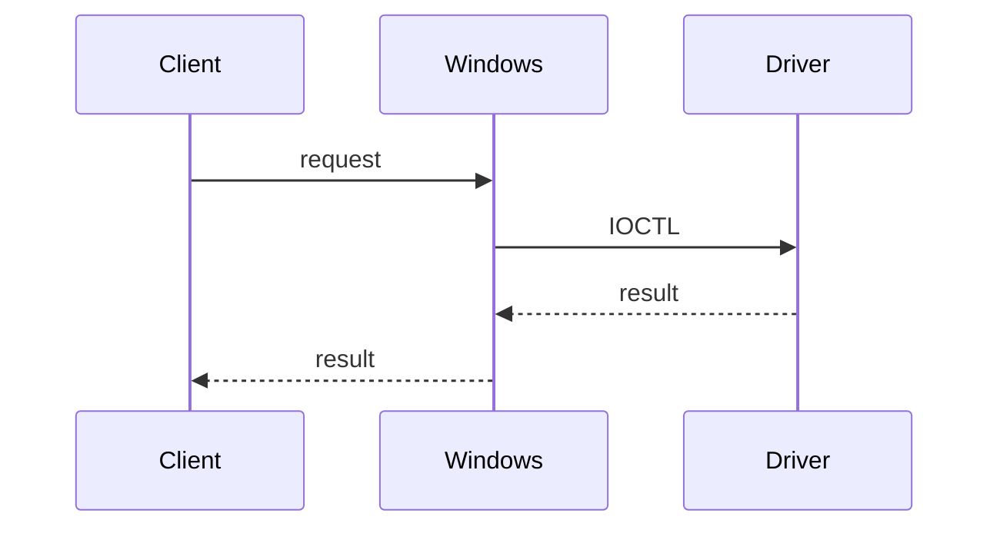

# Incremental learning guides

Owns the guide's lesson content, not a project's delivery plan. Keep the guide
as Markdown at `guide/`: `README.md` gives the reading order and one lesson
lives in each numbered `lessons/NN-topic.md` file. `learning:create-guide`
owns the initial scaffold. Markdown is the source and the reading experience;
do not add renderer configuration, generated HTML, or a publishing destination.

Each lesson starts with one real request, boundary, or small concept from the
current project. Introduce only the prerequisite terms supplied by selected
subject contributors, then link to or show a short excerpt from code that
exists. Use these headings in this order: `What we are following`, `Request
path`, `Read this code`, and `The point`. Explain the direction of control or
data, why the boundary exists, and one thing the reader can now inspect or
explain. Keep it compact enough to read alongside the code.

Add a Mermaid diagram only when a request crosses several boundaries or its
sequence is harder to follow in prose. The surrounding text remains complete:
raw Markdown readers may show the diagram as text rather than render it.

````markdown
# 01 — One request reaches the driver

## What we are following

The client asks for one privileged operation. Windows carries the request to the
driver, which is the only component allowed to perform that work.

## Request path



## Read this code

See `src/client/request.cpp` for request construction and `src/driver/device.cpp`
for the privileged boundary.

## The point

The client requests work; it does not perform driver-owned work itself.
````

Do not turn the guide into a plan, a delivery checklist, a progress ledger, a
knowledge inventory, a glossary, or a complete textbook. Do not quote planned
or invented code. Update a lesson when its quoted code changes, and leave
knowledge promotion to the subject owner after learner evidence.
